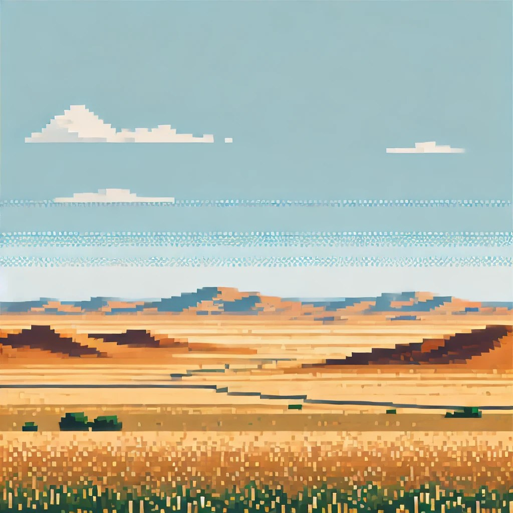
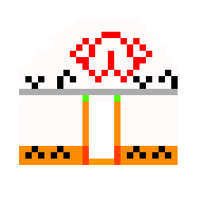
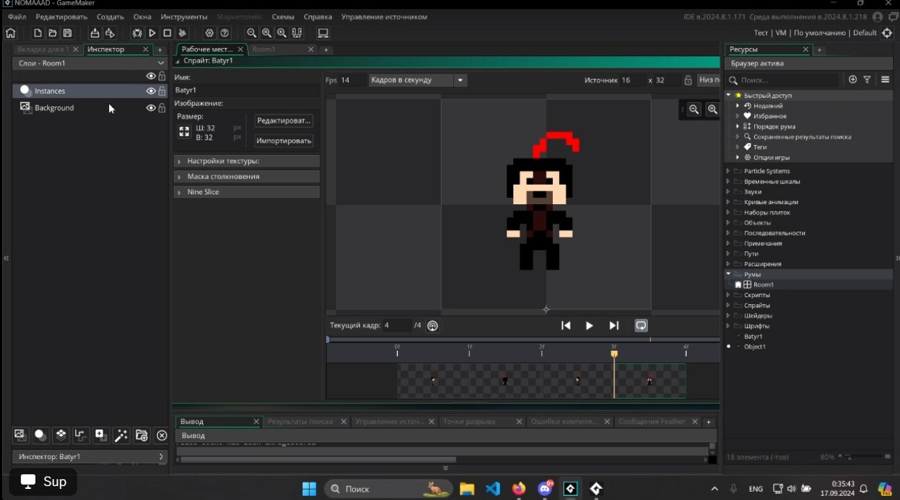
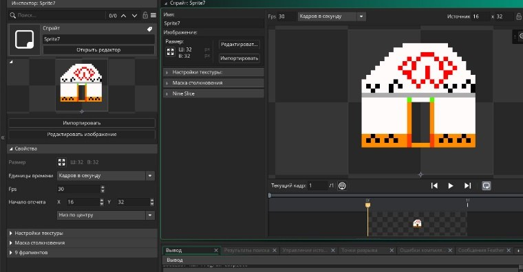
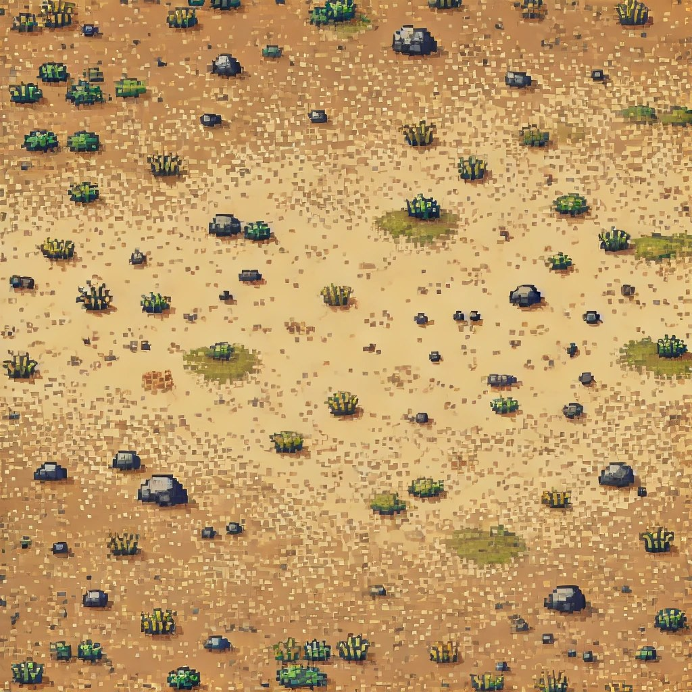
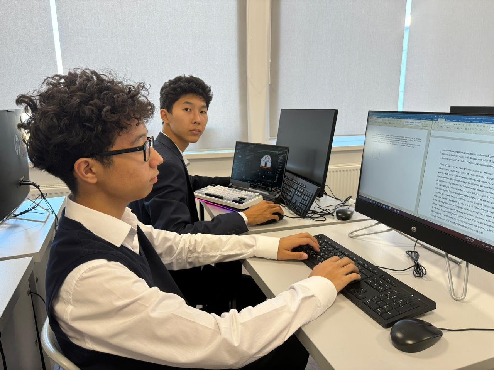

# Great Nomads — «Ұлы көшпенділер» 🐎

A 2D pixel-art game about the nomadic culture of the Kazakh Khanate, made in **GameMaker**.

The idea came during the **World Nomad Games**. Kazakhstan has very few games in Kazakh, and almost none about our own history, so we decided to make one: a game where you live the nomad's life in the steppe. You set up a yurt, manage resources, herd livestock and complete quests about Kazakh crafts and traditions.

🏁 Presented at **KazRoboProject-2024** (KazRobotics, the Kazakhstan Federation of Educational and Sports Robotics)
🗓 Built Dec 2023 – 2024, 9th–10th grade, Specialized Lyceum No. 9 "Zerde", Astana

  
  

## 🎮 Download

**[⬇ Download the game for Windows](../../releases/latest)**

## About the game

- **Genre:** 2D RPG / action
- **Setting:** the Kazakh Khanate, the open steppe
- **Language:** Kazakh
- **Gameplay:** set up a yurt, manage resources, herd livestock, do quests about Kazakh traditions and crafts
- **Goal:** get young people interested in national history and culture through a game, and add more games in the Kazakh language

Inspired by games that brought their culture to the world: *Never Alone* (Inuit culture) and *Valiant Hearts* (World War I).

## Tools

| Tool | Used for |
|---|---|
| **GameMaker** | Engine: game mechanics, character control, animations |
| **Aseprite** | Pixel sprites and animations for characters, objects and environment |
| **Photoshop** | Polishing art and UI elements |
| **Pixel Studio** | Final pixel art optimisation |

## Screenshots & art

| | |
|---|---|
|  |  |
| Character animation in GameMaker | Yurt sprite in the sprite editor |
|  |  |
| Desert tile background | Working on the game |

## What was hard

- Fixing compile errors by going through the code line by line
- Making the pixel art look good on screens with different scales and resolutions
- Syncing character animations with in-game actions
- Combining several tools into one finished game

## Team

- **Adilet Bakytzhanuly** ([@Adikich](https://github.com/Adikich)) — game design, sprites and animations, research into nomadic culture
- **Zhahanger Darimbay** — programming and game mechanics

Supervisor: Gulsara Zhumagatova, computer science teacher, Specialized Lyceum No. 9 "Zerde"
